# Vigil

[](https://github.com/MGuerreiro42/vigil-dashboard/actions/workflows/ci.yml)
[](https://vigil-dashboard-miguelpachiega-6252s-projects.vercel.app)


[](LICENSE)

A live global monitoring dashboard in a terminal skin. Twenty-one public sources (REST, WebSocket and server-sent events) on six keyboard-driven screens, every number labelled with where it came from and how old it is. No backend, no API keys.

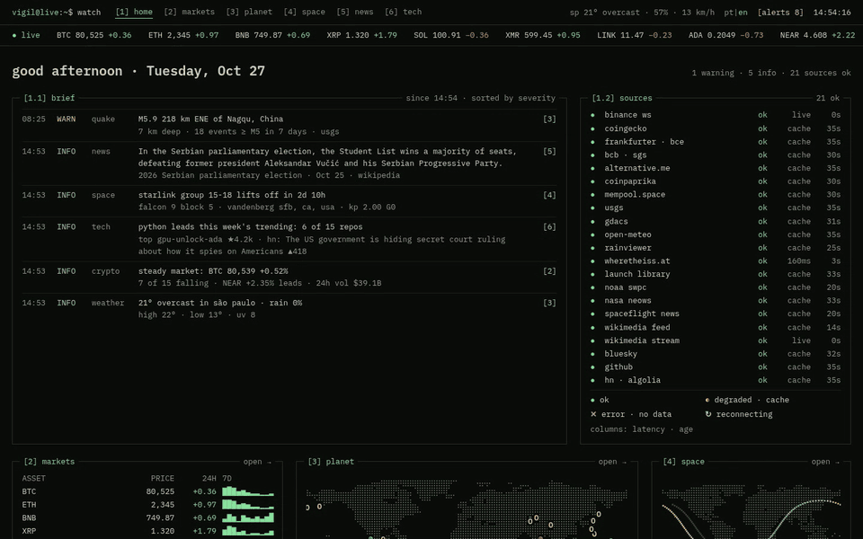

<sub>`1`–`6` switch screens; prices, the ISS and Wikipedia edits update live.</sub>

## Screens

| Key | Screen | What it shows |
|---|---|---|
| `1` | **Overview** | Daily brief ranked by severity, health of every source, one card per screen |
| `2` | **Markets** | Live crypto (7-day chart, order book, trades, buy/sell flow), FX, Brazilian rates, fear & greed |
| `3` | **Planet** | Natural events globe, quake map and scale, weather and air quality, rain radar |
| `4` | **Space** | ISS on a globe with its orbit, launches, space weather, near-Earth asteroids, space news |
| `5` | **News** | Wikipedia headlines, live Wikipedia edits, Bluesky trends, a random article |
| `6` | **Tech** | GitHub trending repositories, Hacker News front page |

<table>
  <tr>
    <td>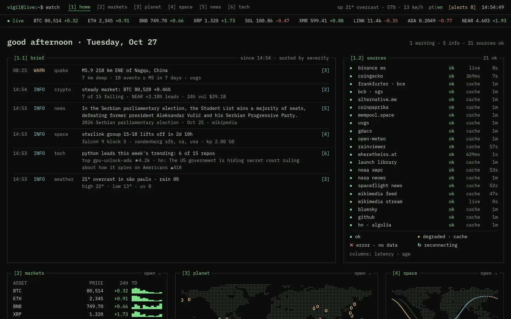</td>
    <td>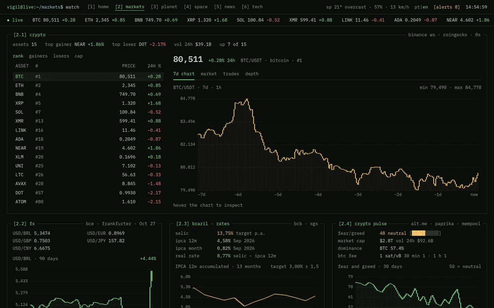</td>
  </tr>
  <tr>
    <td align="center"><sub>Overview: brief and source health</sub></td>
    <td align="center"><sub>Markets: crypto, FX and rates</sub></td>
  </tr>
  <tr>
    <td>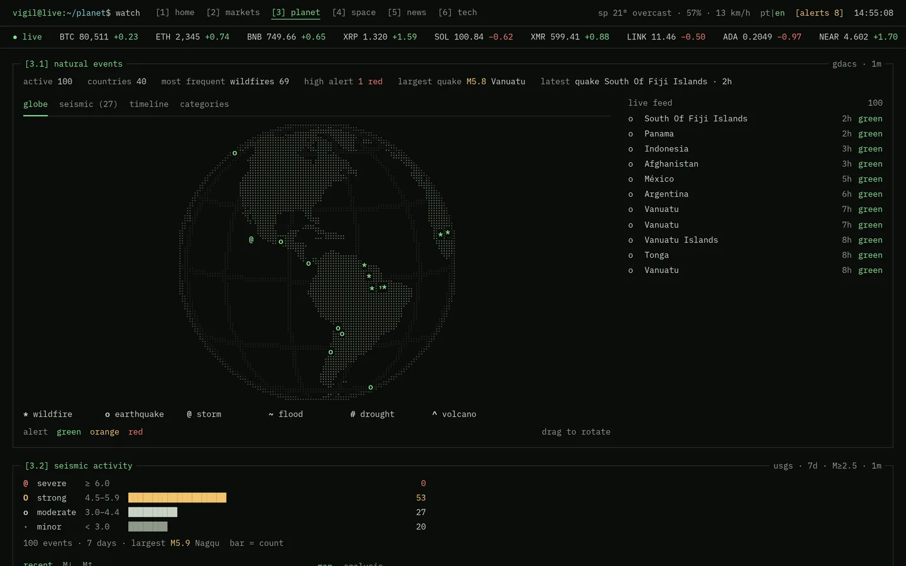</td>
    <td>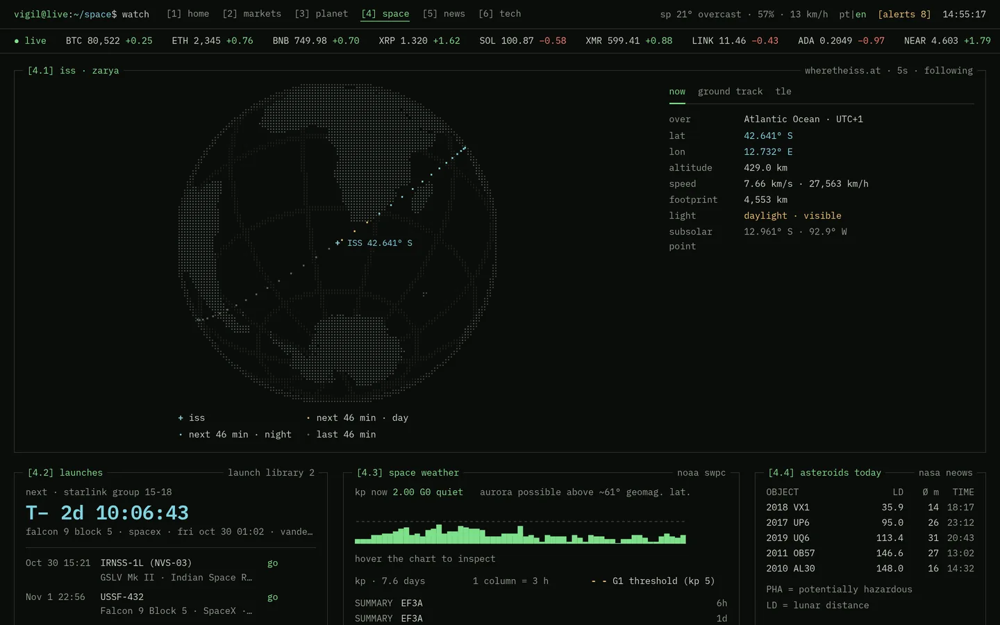</td>
  </tr>
  <tr>
    <td align="center"><sub>Planet: natural events and quakes</sub></td>
    <td align="center"><sub>Space: ISS ground track from its TLE</sub></td>
  </tr>
  <tr>
    <td>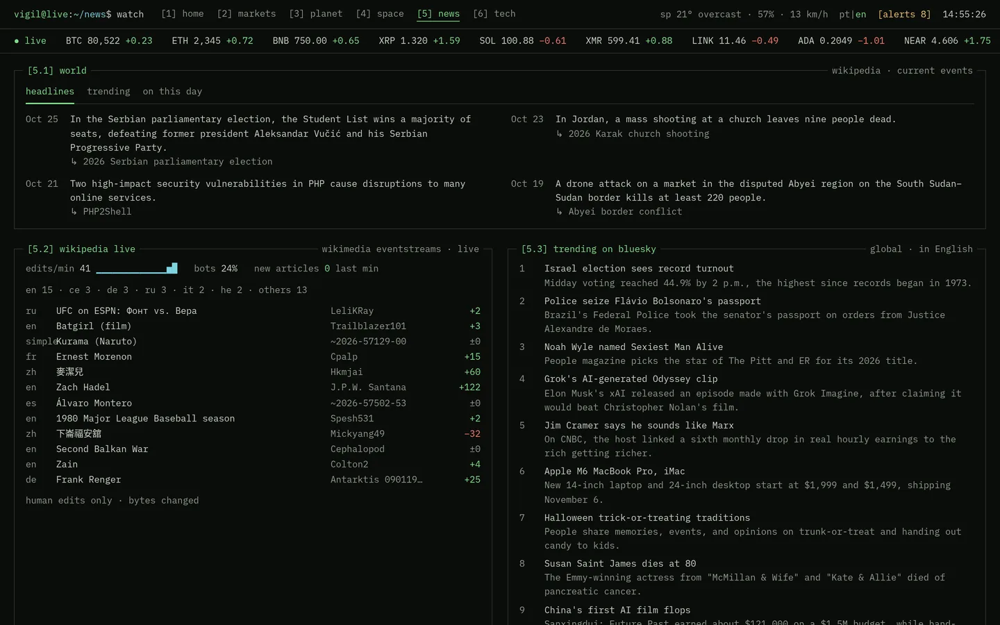</td>
    <td>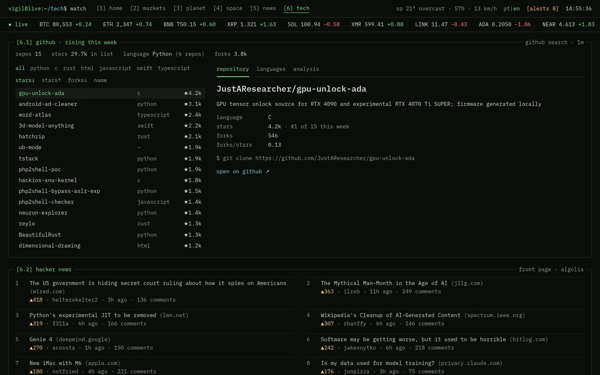</td>
  </tr>
  <tr>
    <td align="center"><sub>News: headlines and live Wikipedia edits</sub></td>
    <td align="center"><sub>Tech: GitHub trending and Hacker News</sub></td>
  </tr>
</table>

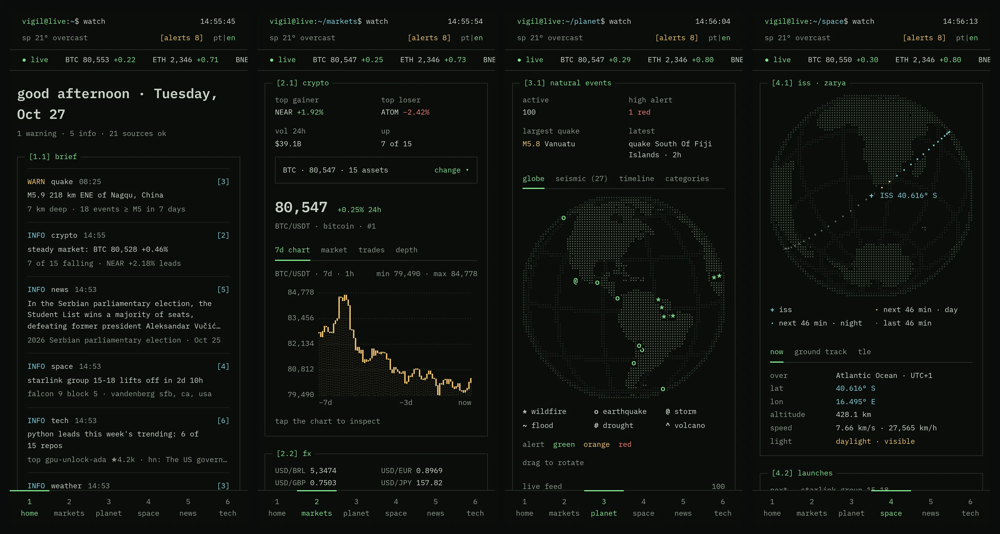

## Features

- **Keyboard first**: `1`–`6` screens, `←/→` tabs, `enter` opens, `r` refreshes the screen. Below 600 px the keybar becomes a bottom tab bar with 44 px targets.
- **Brief**: rule-based rows from every source (quakes, air, weather, crypto, launches, geomagnetic storms, GitHub, HN, headlines, failing sources), stored as message codes so a language switch needs no refetch.
- **Alerts**: quake ≥ M5, AQI ≥ 100, Kp ≥ 5 and 24 h change ≥ 10% raise an alert from any screen. The popover and the brief share one set of thresholds, and dismissed alerts stay dismissed across reloads.
- **Honest data**: each panel shows its source and age; a failing source falls back to its cached answer, in dim, with how old it is.
- **Dot-matrix canvases**: maps and globes drawn as 4 px dots with d3-geo, a dotted line chart with hover/tap readout, text bars and sparklines instead of a chart library.
- **Portuguese and English**, numbers and dates by locale; `prefers-reduced-motion` stops globe rotation and the cursor blink.

## Architecture

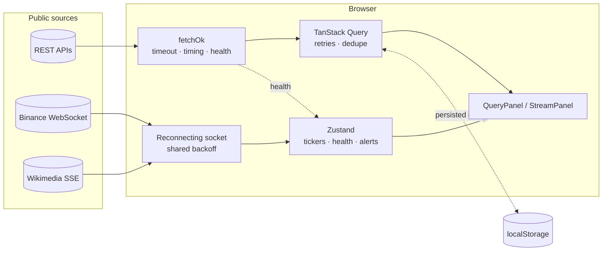

Every source is called straight from the browser: each one was checked for CORS, so there is no proxy. A source registry maps every source to its requests and query keys, which feeds the `[1.2] sources` panel, the brief and the keybar status.

### One panel, five states

Every REST panel goes through `QueryPanel`, so loading, failure and stale data look the same on every screen.

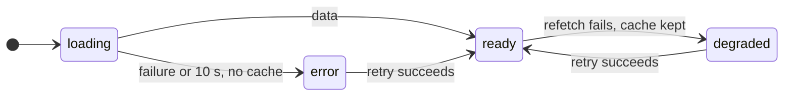

- **Loading** draws dots shaped like the table to come; it starts over when the query key changes (another city).
- **Error** names the cause (HTTP status, timeout, network, rate limit) and retries once per window, honouring `Retry-After`.
- **Degraded** keeps the cached answer on screen, in dim, with its age, even after a reload.

### Live streams

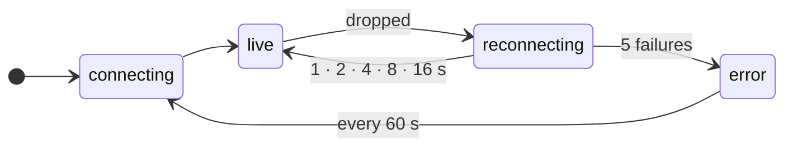

Binance and Wikimedia share one reconnecting helper. While reconnecting, the last values stay on screen in dim with the time they froze; the socket closes while the tab is hidden.

## Tech stack

| | |
|---|---|
| **UI** | React 19, TypeScript 6 (strict), Vite 8, Tailwind CSS 4 (tokens in `@theme`), IBM Plex Mono |
| **Data** | TanStack Query 5 with a persisted cache, Zustand 5, i18next |
| **Visuals** | `<canvas>`, d3-geo, world-atlas, satellite.js (SGP4 orbit of the ISS) |
| **Quality** | Vitest + Testing Library, ESLint, lefthook, commitlint, GitHub Actions |

## Data sources

| Panel | Source | Transport |
|---|---|---|
| Crypto | CoinGecko (Binance REST fallback), Binance streams | REST + WebSocket |
| Economy | Frankfurter (ECB), Banco Central do Brasil SGS, alternative.me, Coinpaprika, mempool.space | REST |
| ISS | Where the ISS at (position, TLE), orbit propagated in the browser | REST + SGP4 |
| Space | Launch Library 2, NOAA SWPC, NASA NeoWs, Spaceflight News | REST |
| Natural events | GDACS | GeoJSON |
| Quakes | USGS Earthquake Catalog | GeoJSON |
| Weather | Open-Meteo forecast, air quality, geocoding | REST |
| Rain radar | RainViewer tiles, sampled into the dot map | REST + tiles |
| News | Wikimedia Feed API, Wikipedia REST | REST |
| Live pulse | Wikimedia EventStreams, Bluesky trending | SSE + REST |
| Tech | GitHub Search API, Hacker News via Algolia | REST |

## Getting started

Requires Node 24 and pnpm.

```bash
pnpm install
pnpm dev        # http://localhost:5173
```

No keys are needed. NASA's asteroid feed runs on the shared `DEMO_KEY` (about 10 requests per hour per IP); for a deploy, set a free key from [api.nasa.gov](https://api.nasa.gov):

```
VITE_NASA_API_KEY=your_key
```

The dev-only `/__primitives` route renders every terminal primitive and every panel state.

## Testing

```bash
pnpm test       # Vitest: parsers, formatting, rules, panel states, stores
pnpm lint
pnpm build      # tsc -b + vite build
```

CI runs lint, tests and build on every pull request and on `main`. Commits follow Conventional Commits (commitlint on `commit-msg`).

## Project structure

```
src/
├── features/      one folder per data domain: api, types, pure helpers, panels
│                  (crypto, economy, earthquakes, natural-events, weather, iss, space,
│                   news, pulse, wikipedia, github, hacker-news, brief, overview)
├── components/
│   ├── layout/    shell: prompt header, ticker, keybar, tab bar, alerts
│   ├── terminal/  Panel, Tabs, DataTable, text bars, QueryPanel / StreamPanel
│   ├── geo/       dot-matrix map and globe canvases
│   └── charts/    dotted line chart canvas
├── hooks/         WebSocket, geolocation, clock, source rows
├── lib/           HTTP, query client, source registry, alert thresholds, formatting, socket
├── pages/         one lazy-loaded page per route
└── store/         Zustand stores shared across features
```

## Deployment

Static SPA on Vercel; `vercel.json` only rewrites client routes to `index.html`. Each screen is its own chunk.

---

*Portfolio project by Miguel Guerreiro. [MIT](LICENSE) licensed.*
